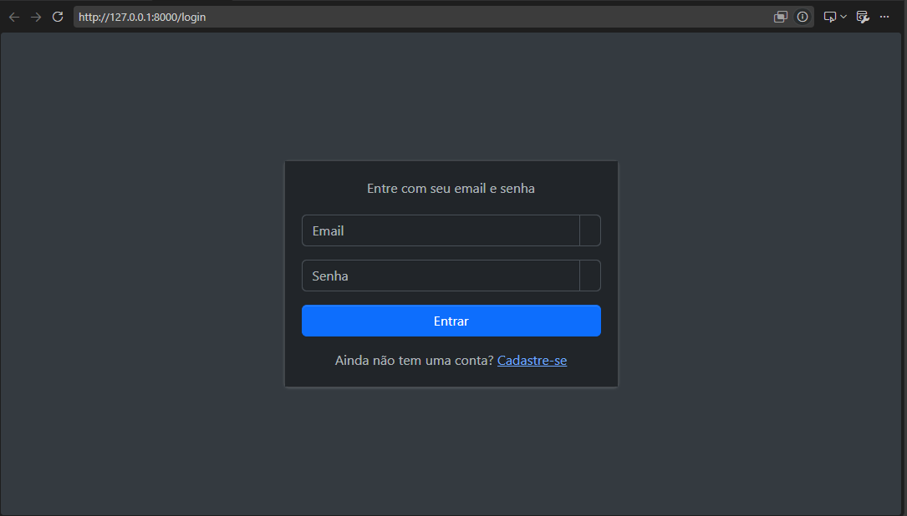
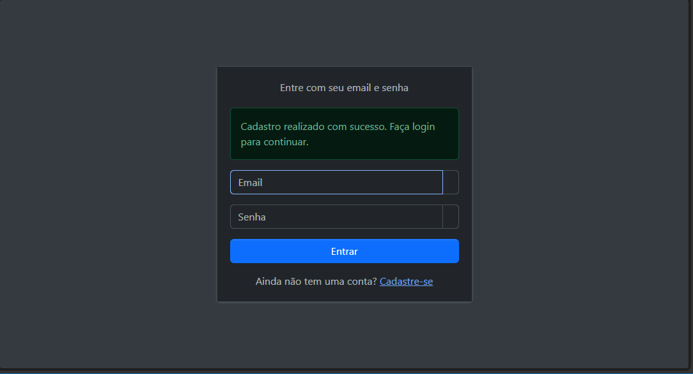
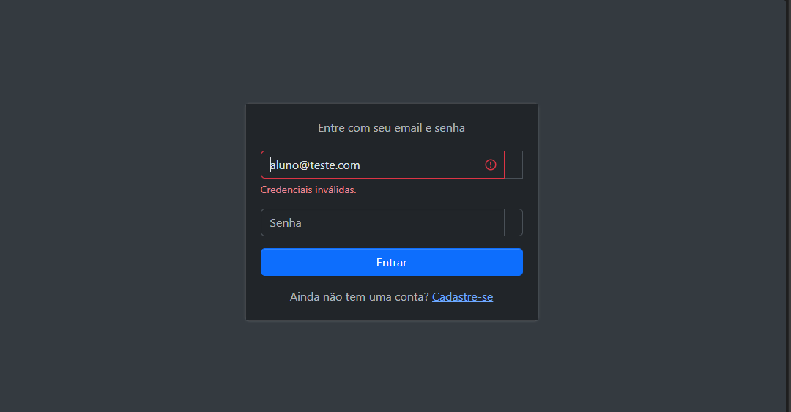
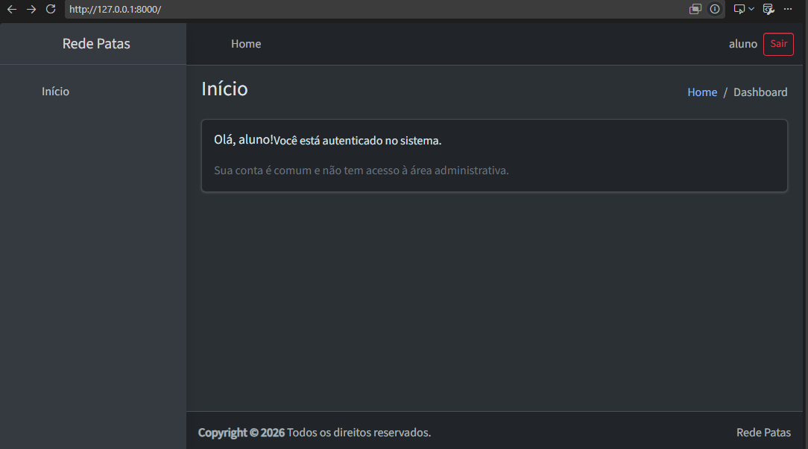
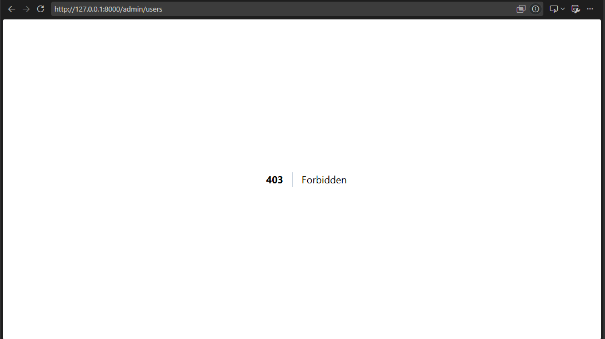
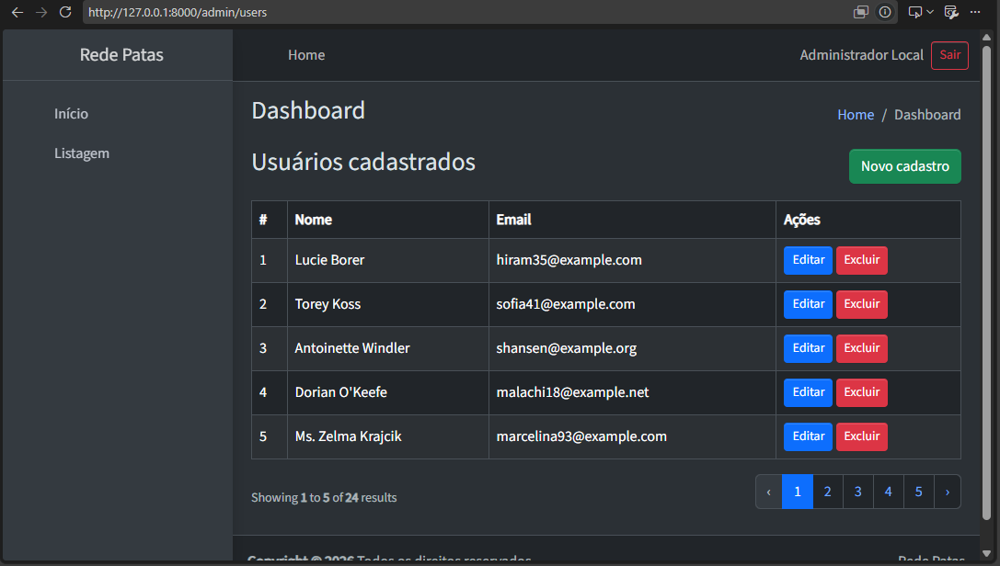

# Autenticação e área administrativa

Atividade prática de autenticação e área administrativa em Laravel, com login, logout, cadastro de usuários e middleware de administrador.

## Como executar localmente

1. Instale as dependências PHP:

   ```bash
   composer install
   ```

2. Copie o arquivo de ambiente de exemplo:

   ```powershell
   Copy-Item .env.example .env
   ```

3. Gere a chave da aplicação:

   ```bash
   php artisan key:generate
   ```

4. Execute as migrations e os seeders:

   ```bash
   php artisan migrate --seed
   ```

   O banco padrão definido em `.env.example` é SQLite (`DB_CONNECTION=sqlite`).

5. Instale as dependências do frontend:

   ```bash
   npm install
   ```

6. Em um terminal, inicie o Vite:

   ```bash
   npm run dev
   ```

7. Em outro terminal, inicie a aplicação:

   ```bash
   php artisan serve
   ```

## Contas de demonstração

O `AdminUserSeeder` cria, somente quando `APP_ENV=local`, a conta de administrador:

- **E-mail:** `admin@example.test`
- **Senha:** `senha-local-123`

Essa conta existe apenas para desenvolvimento local. O cadastro público cria usuários comuns, sem perfil administrativo.

## Rotas

| Método | Caminho | Acesso | Descrição |
|---|---|---|---|
| GET | `/login` | Público | Exibe o formulário de login. |
| POST | `/login` | Público | Realiza o login, protegido pelo limite `throttle:login`. |
| GET | `/register` | Público | Exibe o formulário de cadastro. |
| POST | `/store` | Público | Cria um usuário pelo cadastro. |
| GET | `/` | Autenticado | Exibe a página inicial do usuário autenticado. |
| POST | `/logout` | Autenticado | Encerra a sessão. |
| GET | `/admin/users` | Administrador | Exibe a lista de usuários. |
| GET | `/admin/user/create` | Administrador | Exibe o formulário de criação de usuário no painel. |
| GET | `/admin/user/{user}` | Administrador | Exibe os dados de um usuário. |
| GET | `/admin/user/{user}/edit` | Administrador | Exibe o formulário de edição de usuário. |
| PUT | `/admin/user/{user}` | Administrador | Atualiza os dados de um usuário. |
| PUT | `/admin/user/{user}/profile` | Administrador | Atualiza o perfil de um usuário. |
| DELETE | `/admin/user/{user}` | Administrador | Exclui um usuário. |

Todas as rotas com prefixo `/admin` estão protegidas pelo middleware `admin`.

## Como funciona

- A autenticação usa sessão. O login valida e-mail e senha, autentica o usuário e regenera o identificador da sessão.
- O middleware `EnsureAdmin` redireciona visitantes para `/login`. Usuários autenticados sem perfil administrativo recebem resposta `403`. O acesso é liberado quando o perfil possui `type = admin`.
- Depois do login, usuários comuns são redirecionados para `/`. Administradores são redirecionados para `/admin/users`, respeitando um destino interno solicitado anteriormente quando aplicável.
- O logout é feito por `POST` em `/logout`, invalida a sessão, regenera o token CSRF e redireciona para `/login`.
- A rota `POST /login` usa `throttle:login`:
  - no máximo **5 tentativas por minuto** para a mesma combinação de e-mail e endereço IP;
  - no máximo **20 tentativas por minuto** para o mesmo endereço IP, mesmo usando e-mails diferentes.

  Ao exceder qualquer limite, a requisição retorna ao formulário de login, mantém o e-mail informado e exibe uma mensagem indicando que é necessário tentar novamente após o número de segundos informado.

## Evidências

### Visitante tentando acessar área protegida é redirecionado ao login



Comprova que um visitante que tenta acessar uma área protegida é redirecionado para a tela de login.

### Cadastro de conta comum realizado com sucesso



Comprova que o cadastro público de uma conta comum foi concluído com sucesso.

### Validação de dados inválidos no formulário



Comprova a apresentação de validações quando os dados informados no formulário são inválidos.

### Página inicial do usuário comum autenticado



Comprova o acesso do usuário comum autenticado à página inicial.

### Usuário comum tentando acessar a área administrativa (403)



Comprova que um usuário comum autenticado recebe `403` ao tentar acessar a área administrativa.

### Painel administrativo acessado pelo administrador



Comprova que o administrador consegue acessar o painel administrativo.
