# Atividade prática: autenticação e área administrativa

Implementação do fluxo de login, cadastro, logout e proteção da área administrativa (`/admin/*`) usando autenticação por sessão do Laravel.

## Como executar localmente

Requisitos: PHP 8.4+, Composer, Node.js e SQLite.

```bash
composer install
npm install
cp .env.example .env
php artisan key:generate
touch database/database.sqlite
php artisan migrate --seed
npm run build
php artisan serve
```

Acesse http://127.0.0.1:8000.

### Contas de demonstração

Criadas pelo `DatabaseSeeder` **somente no ambiente `local`** (senhas de exemplo, nunca usar em produção):

| Perfil | Email | Senha |
|---|---|---|
| Administrador (`profile.type = admin`) | `admin@demo.local` | `senha123` |
| Usuário comum (`profile.type = user`) | `usuario@demo.local` | `senha123` |

O cadastro público nunca cria perfil `admin`: o formulário só aceita nome, email e senha. O primeiro administrador é provisionado pelo seeder de desenvolvimento.

### Testes

```bash
php artisan test
```

Os testes em `tests/Feature/AuthFlowTest.php` cobrem login, logout, cadastro, middleware administrativo (redirecionamento/403/acesso), destino pretendido e limite de tentativas.

## O que foi implementado

| Rota | Acesso | Resultado |
|---|---|---|
| `GET /` | Autenticado (`auth`) | Página inicial |
| `GET /login` | Visitante (`guest`) | Formulário de login independente |
| `POST /login` | Visitante, `throttle:5,1` | Valida, regenera a sessão e redireciona |
| `POST /logout` | Autenticado | Invalida a sessão, regenera o CSRF e volta ao login |
| `GET /register` | Visitante | Formulário de cadastro independente |
| `POST /store` | Público (ou admin pelo painel) | Cria um usuário comum |
| `/admin/*` | `auth` + `EnsureAdmin` | Funcionalidades do painel |

- **`app/Http/Middleware/EnsureAdmin.php`**: visitante → redireciona para `/login`; autenticado sem `profile.type = admin` → `403`; admin → segue.
- **Login** (`UserController@login`): mensagem genérica "Credenciais inválidas.", preserva apenas o email, regenera o ID da sessão. Admin vai para `/admin/users` (respeitando o destino pretendido); usuário comum vai para `/`.
- **Cadastro**: público redireciona ao login com confirmação; quando feito por um admin no painel, volta à lista com "Usuário criado com sucesso!". Um usuário autenticado não admin recebe `403` ao tentar usar `POST /store`.
- **Schema**: o model `Profile` usa a tabela `profile` (nome real da migration). O campo `address` foi adicionado por uma migration nova (`2026_11_11_000002_add_address_to_profile_table.php`) com verificação `hasColumn`, sem alterar a migration já aplicada.

### Limite de tentativas de login

A rota `POST /login` usa o middleware `throttle:5,1`: no máximo **5 requisições por minuto** por cliente (identificado pelo IP, para visitantes). A 6ª requisição dentro da janela recebe `429 Too Many Requests` e o contador zera após 1 minuto. Os contadores ficam no cache configurado (`CACHE_STORE`).

Ajuda a dificultar ataques de força bruta, mas tem limitações: um atacante com muitos IPs contorna o limite, usuários atrás do mesmo IP (rede da faculdade, NAT) compartilham o contador, e ele não substitui senhas fortes nem bloqueio/alerta por conta.

## Demonstração dos cenários

Cada captura mostra, no rodapé, a cadeia de requisições HTTP e os códigos de status.

### 1. Visitante tentando abrir `/` e `/admin/users`

Ambos redirecionam (`302`) para o login.

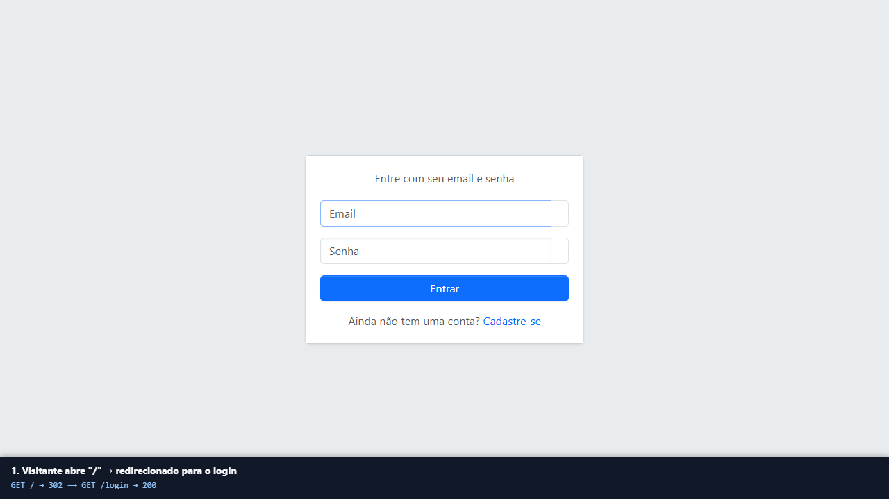
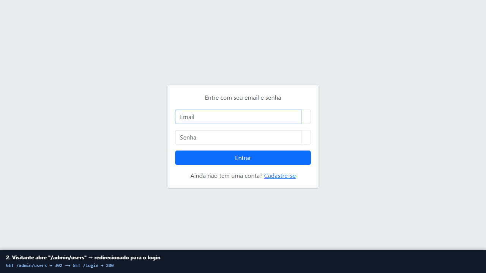

### 2. Cadastro de uma conta comum

Erros de validação (email já usado, senha curta) com nome e email preservados e senha em branco:

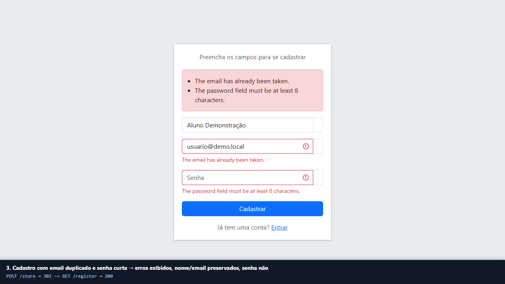

Cadastro concluído, com redirecionamento ao login e confirmação:

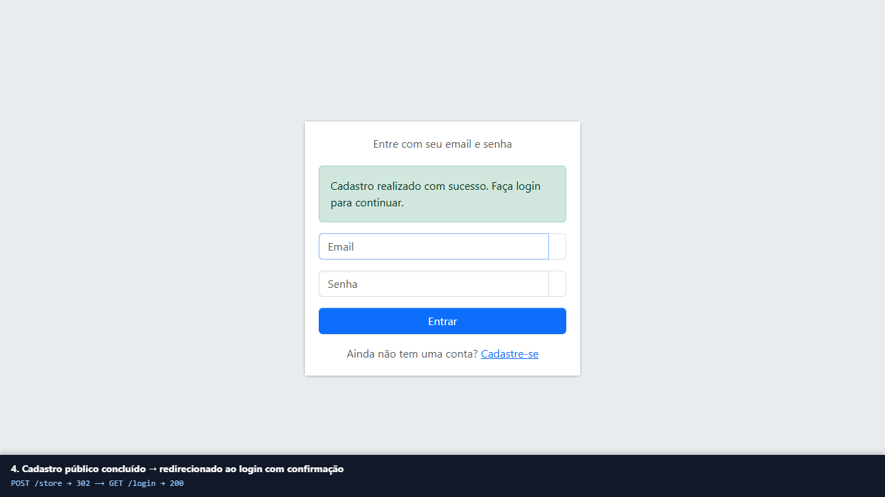

### 3. Login e logout da conta comum

Credenciais inválidas: mensagem genérica, email preservado, senha não repopulada:

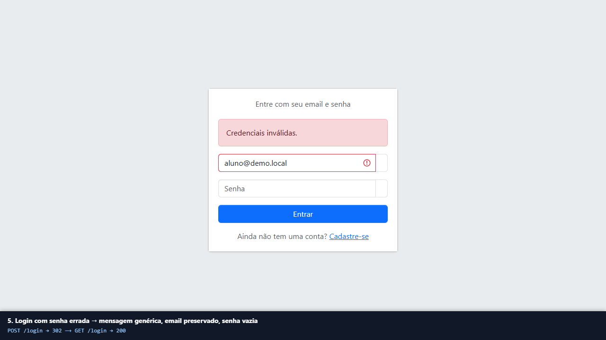

Login bem-sucedido do usuário comum, encaminhado para `/` (botão **Sair** no header):

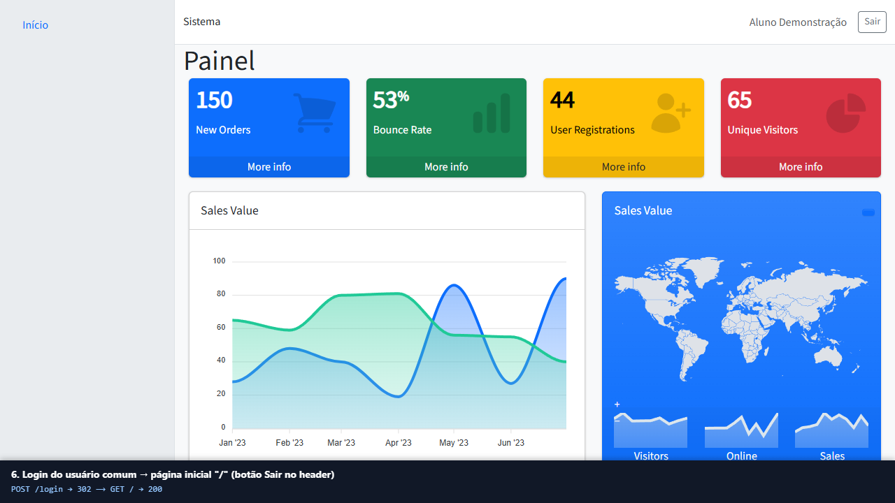

Logout via `POST /logout` com CSRF, de volta ao login, e `/` volta a exigir autenticação:

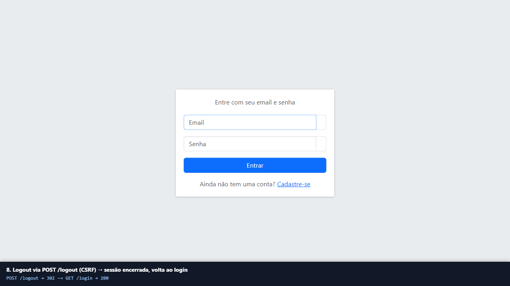
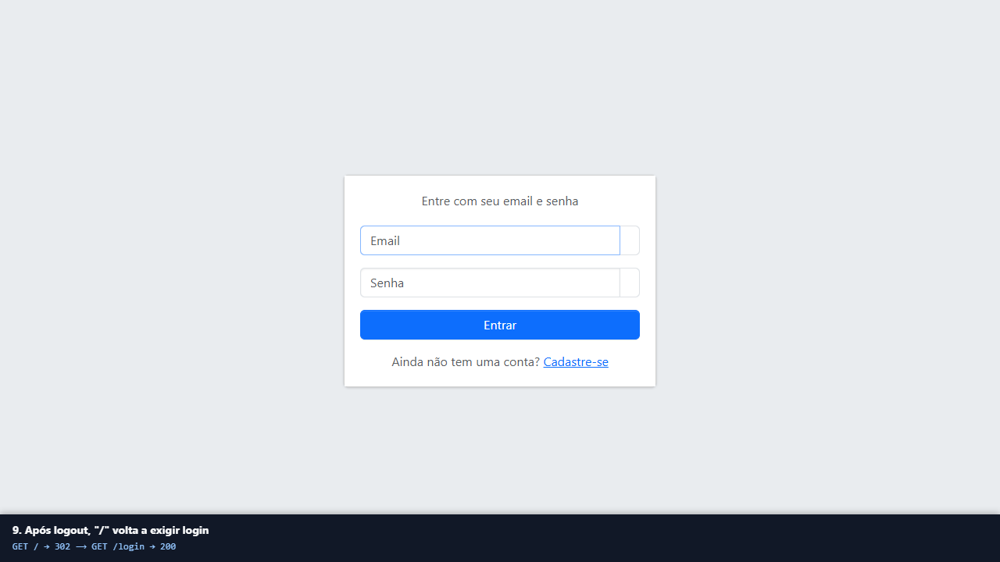

### 4. Tentativa de acesso administrativo pela conta comum: 403

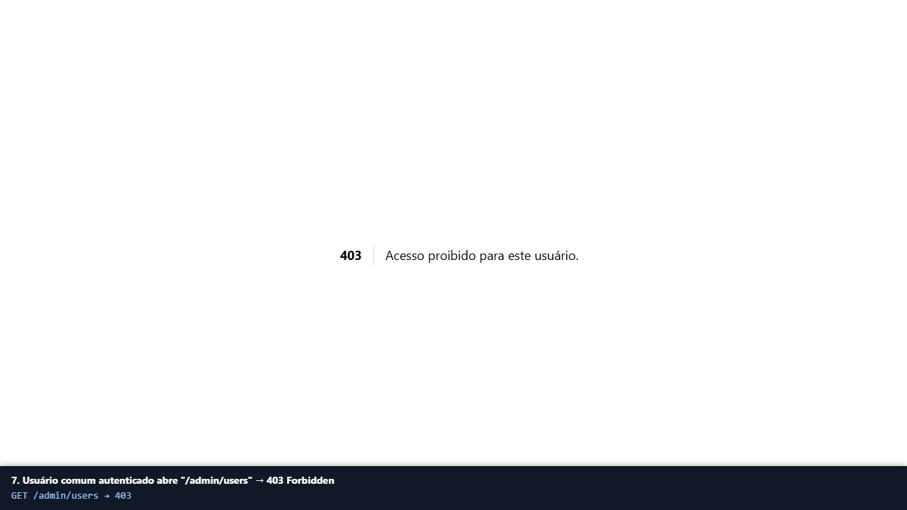

### 5. Login do administrador e acesso ao painel

O admin tentou abrir `/admin/users`, foi enviado ao login e, ao autenticar, voltou ao destino pretendido:

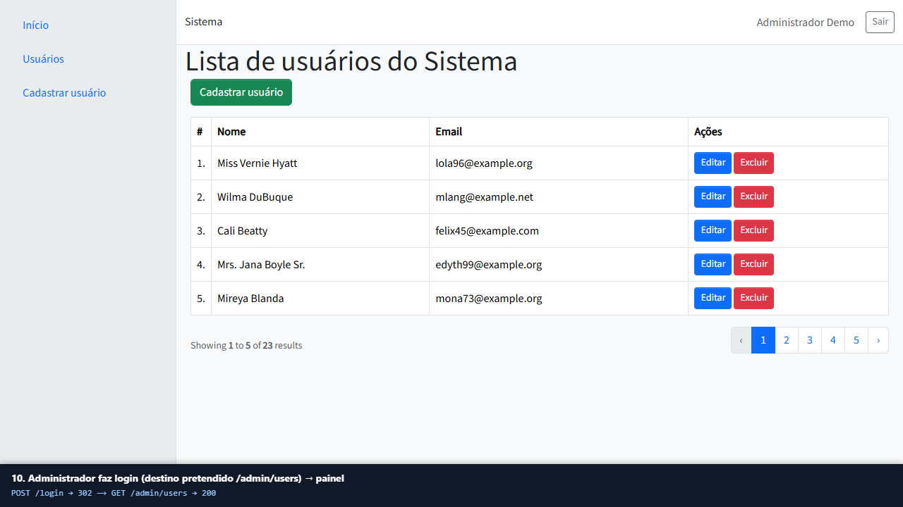

Cadastro de usuário pelo painel, com retorno à lista e mensagem:

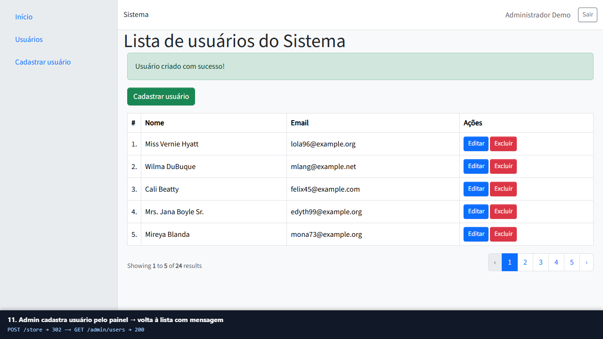

### 6. Limite de tentativas

Sexta tentativa de login dentro de 1 minuto:

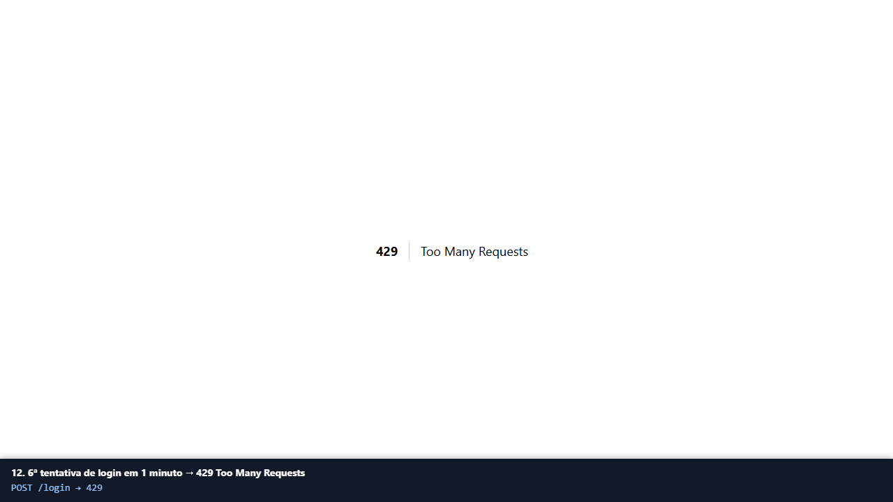
