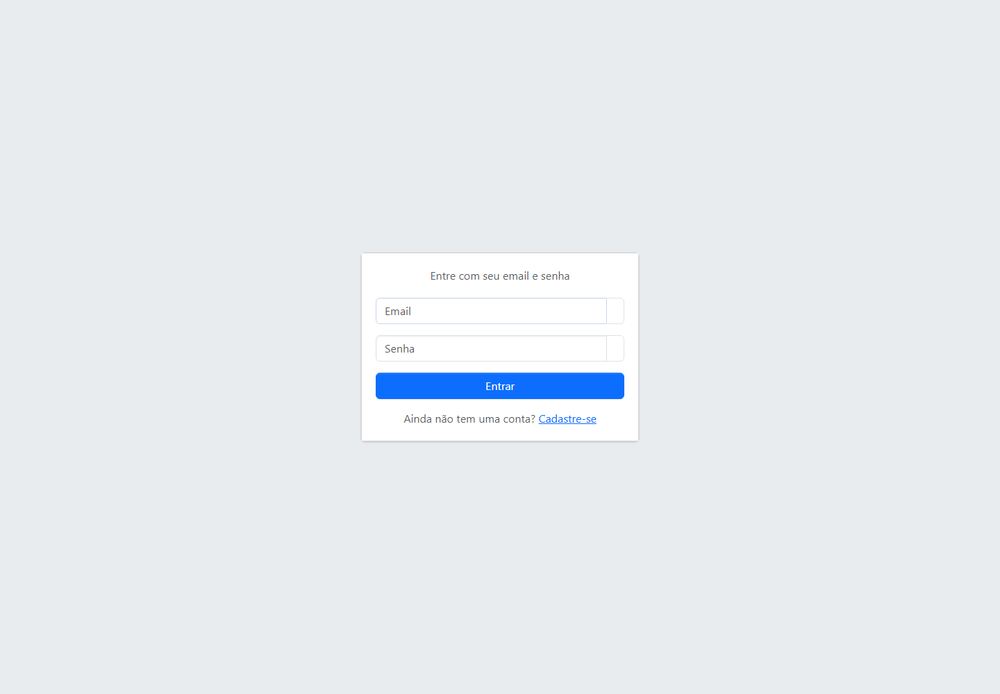
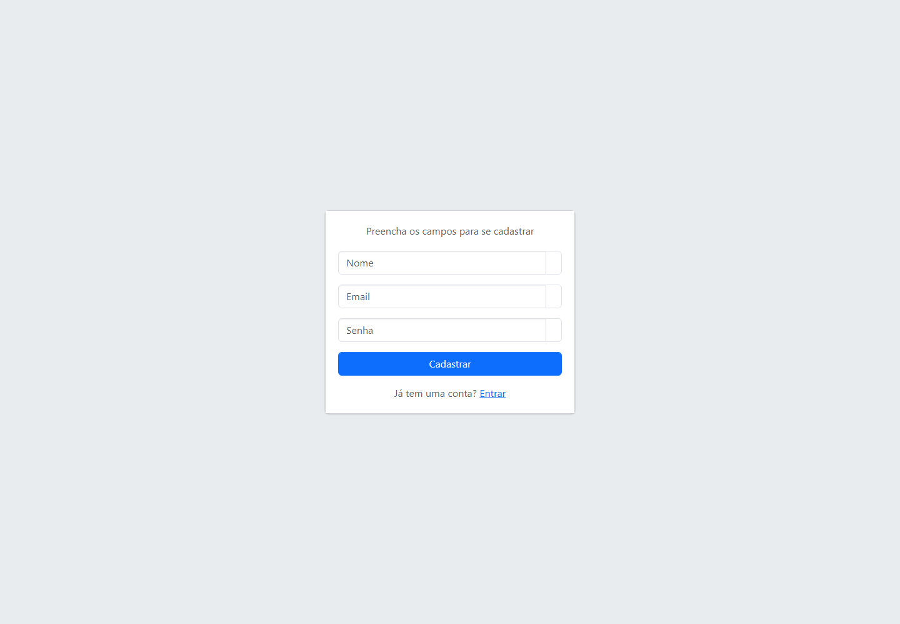
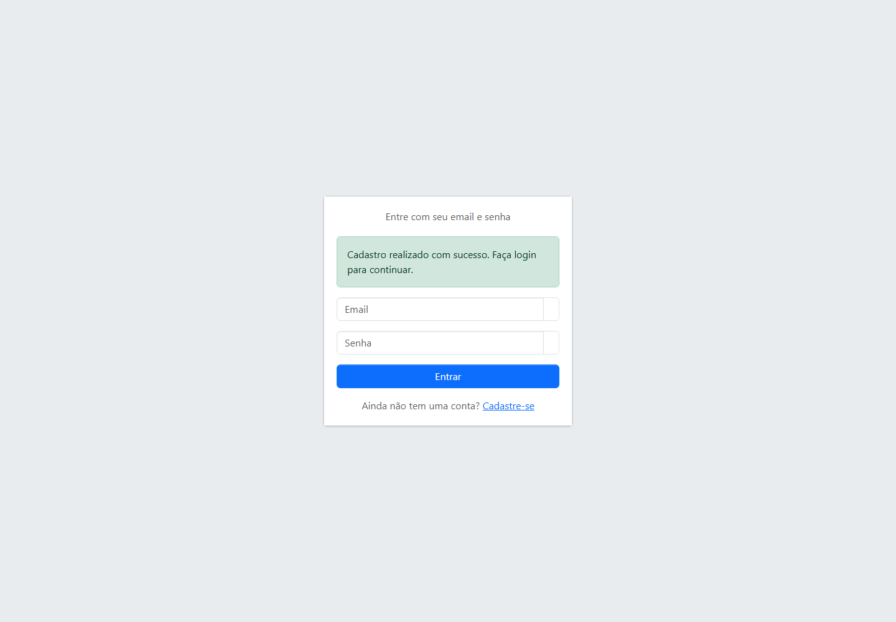
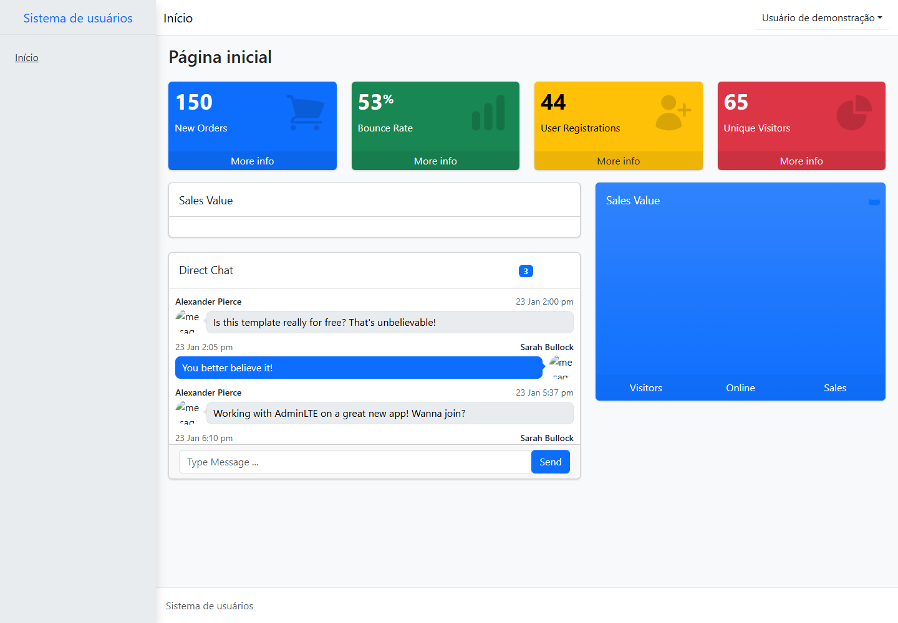
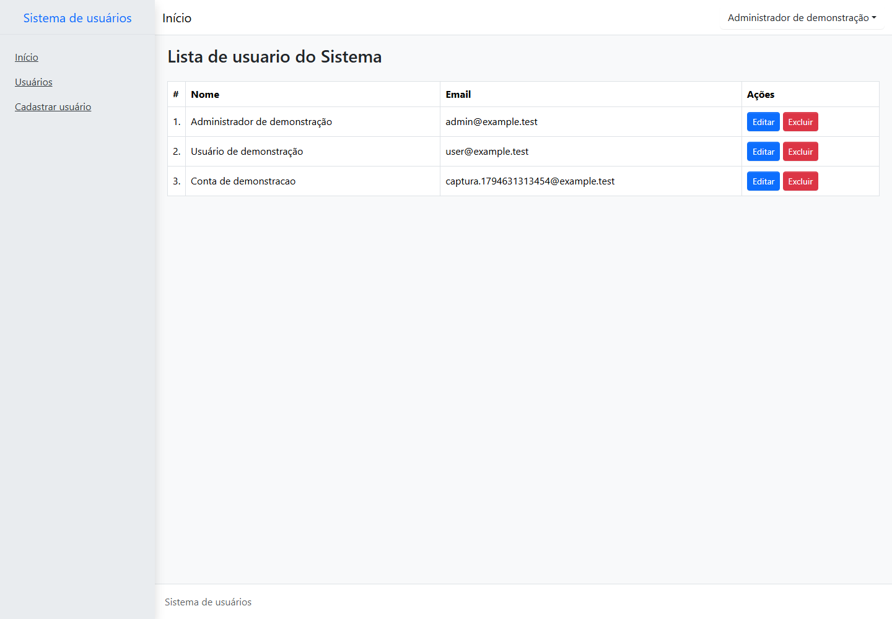
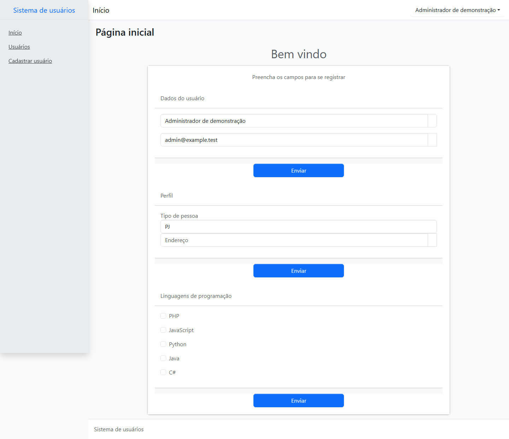
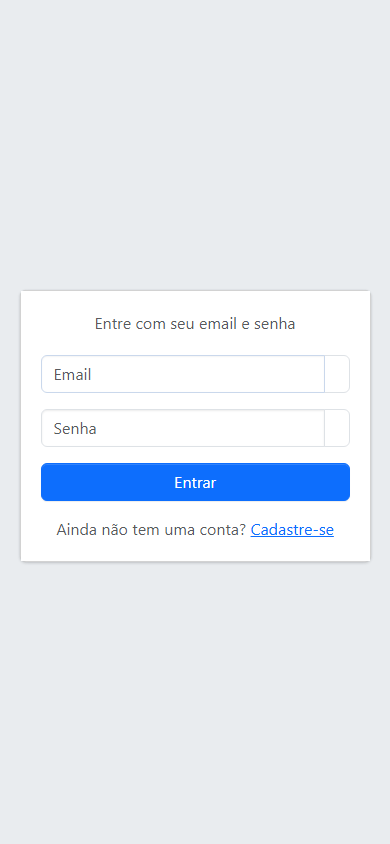

<p align="center"><a href="https://laravel.com" target="_blank"></a></p>

<p align="center">
<a href="https://github.com/laravel/framework/actions"></a>
<a href="https://packagist.org/packages/laravel/framework"></a>
<a href="https://packagist.org/packages/laravel/framework"></a>
<a href="https://packagist.org/packages/laravel/framework"></a>
</p>

## Validação da atividade: autenticação e área administrativa

Os cenários abaixo foram executados no navegador com Playwright. As capturas estão em [`docs/capturas`](docs/capturas).

### 1. Visitante acessando páginas protegidas

Ao tentar acessar `/` ou `/admin/users` sem autenticação, o visitante é redirecionado para `/login`.



### 2. Credenciais inválidas

Uma tentativa com senha incorreta exibe uma mensagem genérica, mantém o email e limpa a senha.


### 3. Cadastro de uma conta comum

O formulário independente solicita nome, email e senha. Após o cadastro, o visitante retorna ao login com uma confirmação, sem receber privilégios administrativos.





### 4. Login da conta comum

Com as credenciais da conta cadastrada, o login encaminha o usuário para a página inicial (`/`).



### 5. Acesso administrativo negado

Ao acessar `/admin/users`, uma conta comum autenticada recebe uma resposta HTTP **403**.


### 6. Logout

O botão **Sair** envia um formulário POST com CSRF, encerra a sessão e redireciona para o login.


### 7. Login do administrador e acesso ao painel

Uma conta com perfil `type = admin` é encaminhada para `/admin/users` e pode acessar as telas administrativas.





### 8. Login em tela de celular



### Verificações complementares

A validação automatizada com `php artisan test --compact` passou com **26 testes e 96 asserções**. O build com `npm run build` também foi concluído. As capturas demonstram os estados visuais; os testes HTTP verificam autenticação, autorização, sessão, validação e persistência.

O login permite **5 envios por minuto por combinação de email e IP**. A sexta tentativa dentro desse período recebe HTTP **429**, e novas tentativas são permitidas após a expiração da janela.

Para provisionar as contas de demonstração em ambiente `local`, execute após as migrations:

```bash
php artisan db:seed --class=DemoUsersSeeder
```

| Conta | Email | Senha local de demonstração |
| --- | --- | --- |
| Administrador | `admin@example.test` | `DemoLocal123!` |
| Usuário comum | `user@example.test` | `DemoLocal123!` |

## About Laravel

Laravel is a web application framework with expressive, elegant syntax. We believe development must be an enjoyable and creative experience to be truly fulfilling. Laravel takes the pain out of development by easing common tasks used in many web projects, such as:

- [Simple, fast routing engine](https://laravel.com/docs/routing).
- [Powerful dependency injection container](https://laravel.com/docs/container).
- Multiple back-ends for [session](https://laravel.com/docs/session) and [cache](https://laravel.com/docs/cache) storage.
- Expressive, intuitive [database ORM](https://laravel.com/docs/eloquent).
- Database agnostic [schema migrations](https://laravel.com/docs/migrations).
- [Robust background job processing](https://laravel.com/docs/queues).
- [Real-time event broadcasting](https://laravel.com/docs/broadcasting).

Laravel is accessible, powerful, and provides tools required for large, robust applications.

## Learning Laravel

Laravel has the most extensive and thorough [documentation](https://laravel.com/docs) and video tutorial library of all modern web application frameworks, making it a breeze to get started with the framework.

In addition, [Laracasts](https://laracasts.com) contains thousands of video tutorials on a range of topics including Laravel, modern PHP, unit testing, and JavaScript. Boost your skills by digging into our comprehensive video library.

You can also watch bite-sized lessons with real-world projects on [Laravel Learn](https://laravel.com/learn), where you will be guided through building a Laravel application from scratch while learning PHP fundamentals.

## Agentic Development

Laravel's predictable structure and conventions make it ideal for AI coding agents like Claude Code, Cursor, and GitHub Copilot. Install [Laravel Boost](https://laravel.com/docs/ai) to supercharge your AI workflow:

```bash
composer require laravel/boost --dev

php artisan boost:install
```

Boost provides your agent 15+ tools and skills that help agents build Laravel applications while following best practices.

## Contributing

Thank you for considering contributing to the Laravel framework! The contribution guide can be found in the [Laravel documentation](https://laravel.com/docs/contributions).

## Code of Conduct

In order to ensure that the Laravel community is welcoming to all, please review and abide by the [Code of Conduct](https://laravel.com/docs/contributions#code-of-conduct).

## Security Vulnerabilities

If you discover a security vulnerability within Laravel, please send an e-mail to Taylor Otwell via [taylor@laravel.com](mailto:taylor@laravel.com). All security vulnerabilities will be promptly addressed.

## License

The Laravel framework is open-sourced software licensed under the [MIT license](https://opensource.org/licenses/MIT).
